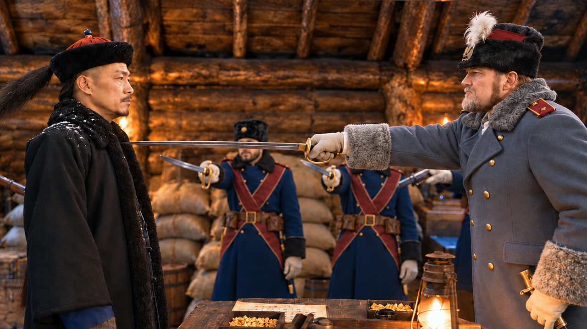
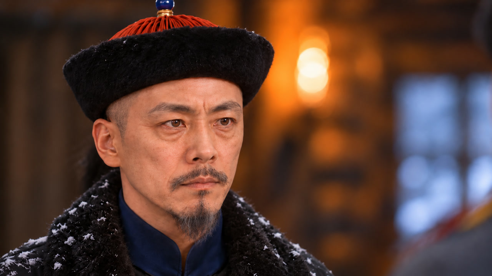
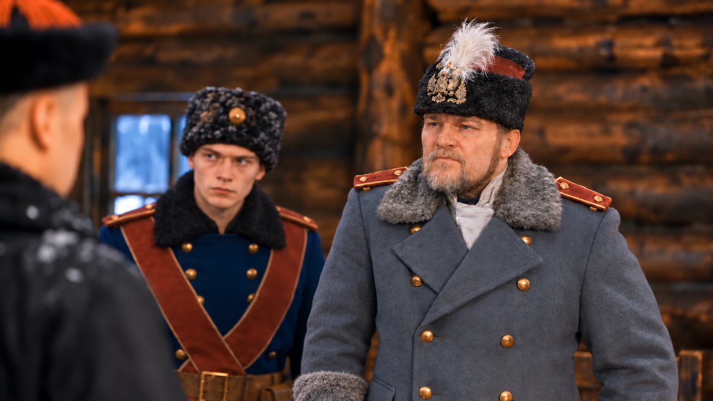
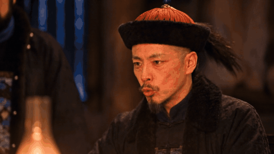
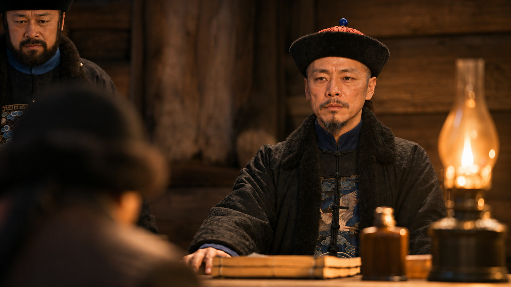
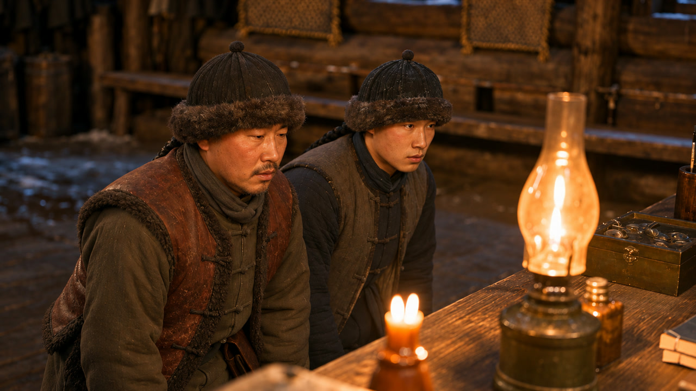
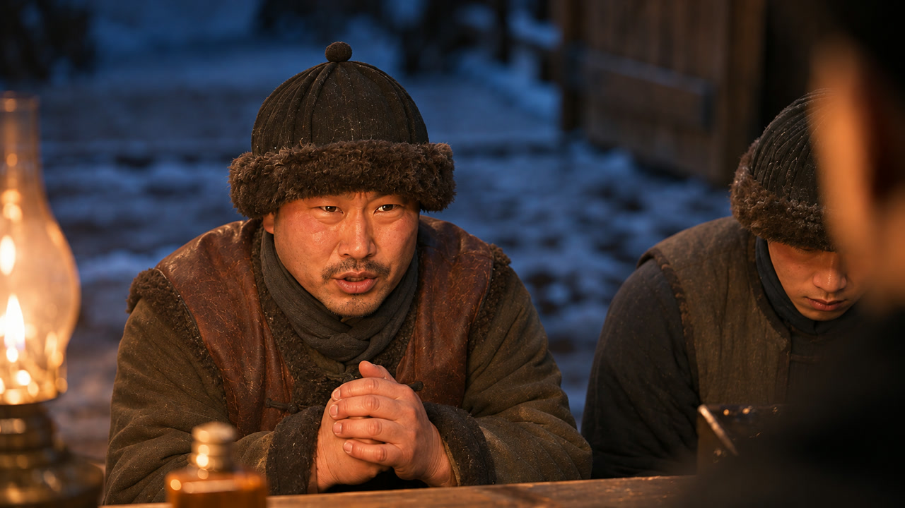

# Film Prompt Skills

**把剧本写成可以执行的镜头，让人物在交流，让场面有变化。**

面向历史剧情片、人物传记与严肃剧情的 **Seedance 2.5 中文分镜提示词技能**。保留原对白，将人物互动、动作因果、空间调度、光线与声音组织成每组不超过30秒的生成提示词。



[实际案例](#实际案例) · [技能解决什么问题](#技能解决什么问题) · [安装](#在-codex-中安装) · [使用](#如何提供材料) · [完整文字案例](#完整文字案例) · [使用限制](#使用限制)

## 实际案例

以下剧照与生成视频由仓库维护者提供，来自《金圣千秋》制作过程。静态剧照展示人物、构图与光线，视频用于查看实际动作和切镜；两者不逐帧对应。这些是经过制作与迭代的选段，不代表单次生成即可复现的效果。

### 案例一：第18组前半段——刀锋下的交涉

**展示重点：威胁距离、人物目光，以及说话者与听者之间的压力传递。**

下方动图对应提供的约7.07秒视频，即第18组的前半段节选，并非该组完整30秒成片。动图无声，带声音版本见视频链接。

[](https://github.com/flemin86/film-prompt-skills/raw/refs/heads/main/assets/showcase/negotiation-group18-excerpt.mp4)

[观看／下载带声音视频 · 约7秒 · 720p](https://github.com/flemin86/film-prompt-skills/raw/refs/heads/main/assets/showcase/negotiation-group18-excerpt.mp4)

| 李的目光与面部细节 | 首领及护卫的反馈 |
| --- | --- |
|  |  |

这一类场景，提示词需要回答三个问题：

- **观众看清什么？** 刀与人物的距离、动作的发起者，以及对方的即时反应。关键接近或接触发生时，应保留足以看懂空间关系的画面。
- **人物在争取什么？** 李试图让对方接受依据和退路；首领在判断是否还能通过威胁压服来访者。表演围绕交流目的推进。
- **为什么在这里切镜？** 切到听者，是为了看到说话产生的效果；切回说话者，是因为他察觉了反馈并继续推进。对白在切镜后仍从当前音频位置接续。

<details>
<summary>查看动作与表演的写法示例</summary>

以下为方法说明节选，不是完整生成提示词，也不声称与展示视频逐帧一致：

```text
画面动作：李确认近处刀尖的位置，随后抬眼看向首领，站稳继续说明。
表演细节：他感受到危险，仍决定把话说清。目光与呼吸接住当前压力，
不以全身僵住来表达沉着。

画面动作：首领注意到对方没有退让，目光从刀尖转回李的脸上。
表演细节：原先的施压没有得到预期回应，他开始重新判断对方的决心。

音频状态：切至首领反应时，李保持同空间画外声，
继续当前父音轨位置，不重新起句、不重复发声。
```

</details>

### 案例二：室内问询——求饶、倾听与起身施压

**展示重点：同一场谈话中，人物姿态、听者反应和机位如何随局势变化。**

这是另一段独立场景，不是上方第18组的后半段。完整提供的视频约28秒；下方动图选取约20–27.5秒，展示李从坐姿转为起身、指向对方的过程。

[](https://github.com/flemin86/film-prompt-skills/raw/refs/heads/main/assets/showcase/hearing-dialogue.mp4)

[观看／下载带声音视频 · 约28秒 · 720p](https://github.com/flemin86/film-prompt-skills/raw/refs/heads/main/assets/showcase/hearing-dialogue.mp4)

| 桌后倾听 | 双人反馈 | 求饶近景 |
| --- | --- | --- |
|  |  |  |

- **让动作承担关系变化。** 求饶者抱手、低头、察看对方脸色；听者先观察，再作出回应。起身是情绪和决定的发展，不是为了给静态画面增加活动。
- **让同框人物有不同反应。** 一个人急于解释，另一个人可能回避目光；不要求所有人同步点头、转头或做同一种表情。
- **让光线属于场景。** 先确定油灯、窗户等光源的位置，再描述人物坐下、转头和站起后的受光变化，避免每次反打重新设置光向。

## 技能解决什么问题

| 常见问题 | 编写方法 |
| --- | --- |
| 人物只有嘴在动，表情与身体僵住 | 写出交流目的、受到的刺激及对方反馈，允许自然的视线、肩部与重心变化 |
| 人物走动后换位、穿桌，下一镜又回原处 | 先确定家具锚点、起点、可走路线与终点，复杂调度先画俯视动线图 |
| 镜头不少，但信息与压力没有变化 | 按观众获得的信息和人物判断组织镜头，删减重复过渡，保留关键反应 |
| 切镜后对白重读，或长台词难以生成 | 一条发声事件覆盖多个内部画面；用户授权拆分时按完整意群分段，逐段标明音频位置 |
| 相邻两组开头结尾雷同、难剪接 | 将上一组末镜和下一组首镜一起设计，可用听者反应或双人画面承接 |
| 道具、姿态或情绪在下一组被重置 | 继承已确认的持握手、接触状态、站坐姿态、已知事实与谈判进展 |
| 每场都靠急推或快切制造气氛 | 只在有明确触发和戏剧作用时采用强调运镜，普通交流优先由表演承担 |

技能主要输出提示词；角色造型、场景参考图和视频生成需在相应制作环节完成。

## 在 Codex 中安装

### 人物、服装与道具设计

新增 [film-character-costume-prop-design](skills/film-character-costume-prop-design/SKILL.md)：从剧本拆分人物、服装和关键道具，支持原创设计、照片或史料参考，输出独立中文生图提示词或参考图。人物默认交付面部特写、正面、侧面和背面四视图；换装与年龄变化保留人物身份，并检查身体比例、站姿和服装结构的一致性。

```text
请使用 $skill-installer 安装这个 GitHub 仓库里的技能：
https://github.com/flemin86/film-prompt-skills/tree/main/skills/film-character-costume-prop-design
```

使用时可直接说明：`使用 $film-character-costume-prop-design，按我提供的剧本与参考图，设计人物、服装和关键道具。`

### 影视分镜提示词

将以下内容发给 Codex：

```text
请使用 $skill-installer 安装这个 GitHub 仓库里的技能：
https://github.com/flemin86/film-prompt-skills/tree/main/skills/seedance-cinematic-film-prompts
```

安装完成后，在下一轮对话中调用；如果未出现，重启 Codex 后再试。安装命令是对 Codex 的请求，不是终端命令。目标目录已有同名技能时，先处理版本选择，不直接覆盖本地修改。

## 如何提供材料

提供剧本、要处理的范围和已经确认的参考素材即可；续写同场景时，补充上一组的实际结尾，有助于保持连续。

```text
使用 $seedance-cinematic-film-prompts，生成下面这场戏的分镜提示词。

【剧本与对白】
（粘贴剧本，注明必须保留的台词）

【生成范围与时长】
（本次生成哪一段，每组最长30秒；有指定节奏或总时长时说明）

【参考与连续状态】
（附人物、场景或已生成画面；说明各参考的用途）
（续作时说明上一组结束的站位、姿态、持有道具和情绪进展）

【要求】
保留原对白，先按剧情设计自然互动与空间关系，再选择镜头。
长台词如需拆分，先提出分段建议，不自行删改文字。
保持轴线、灯位、道具和相邻组衔接。不生成字幕和配乐。
```

输出会按“统一视觉描述—对白连续性—父片段—内部画面镜头”组织，镜头包含景别、机位、运镜、构图、场景氛围、画面动作、表演与音频状态等必要字段。完整结构见[输出格式参考](skills/seedance-cinematic-film-prompts/references/output-format.md)。

## 完整文字案例

- [原创输入剧本：《夜仓分粮》](examples/夜仓分粮/01_输入剧本.md)
- [对应提示词输出](examples/夜仓分粮/02_分镜提示词.md)

《夜仓分粮》使用独立虚构人物，展示从文字剧本到完整分镜提示词的组织方式，不对应上方两段视频。可结合实际案例理解方法，再参考文字案例查看完整格式。

## 技能目录

```text
skills/seedance-cinematic-film-prompts/
├── SKILL.md
├── agents/openai.yaml
├── references/
│   ├── film-language.md
│   ├── spatial-continuity.md
│   └── output-format.md
└── scripts/
    ├── check_seedance_timing.py
    └── check_dialogue_exact.py
```

请保留整个技能目录，参考文件与脚本供技能按需调用。自动检查脚本需要 Python 3。示例剧照、动图和视频放在 `assets/showcase/`，仅用于仓库页面展示，安装技能无需复制该展示目录。

## 使用限制

本仓库公开供个人非商业学习和使用，**不授权修改、转载或商用**，不采用 MIT 等开源许可证。完整条件见 [LICENSE](LICENSE)。请从本仓库下载完整原版，不重新分发副本。

展示素材不因公开展示而额外授予转载或商用许可。视频、剧照和动图用于说明制作方法，不构成特定模型输出效果、历史考据或一次生成成功率的保证。
